# 📡 Awesome IoT Analytics & Event Monitoring

<p align="center">
  
</p>

<p align="center">
  <a href="https://github.com/ishandutta2007/Awesome-Awesome-Awesome"></a>
  <a href="https://discord.gg/jc4xtF58Ve"></a>
  <a href="https://github.com/ishandutta2007/Awesome-IoT-Analytics-Event-Monitoring/stargazers"></a>
  <a href="https://github.com/ishandutta2007/Awesome-IoT-Analytics-Event-Monitoring/network/members"></a>
  <a href="https://github.com/ishandutta2007/Awesome-IoT-Analytics-Event-Monitoring/blob/main/LICENSE"></a>
  <a href="https://github.com/ishandutta2007/Awesome-IoT-Analytics-Event-Monitoring/pulls"></a>
  <a href="https://github.com/ishandutta2007"></a>
</p>

---

## 🎯 Overview & Mission

A curated, production-ready directory of enterprise **SaaS platforms** and **open-source software** for **IoT Analytics, Device Telemetry, and Real-Time Event Monitoring**. 

These tools ingest multi-protocol telemetry from connected edge devices, process massive streaming event volumes, detect operational anomalies, track asset health, and power real-time operational dashboards across **Industrial IoT (IIoT)**, **smart energy**, **logistics fleets**, **smart buildings**, and **consumer hardware ecosystems**.

> 💡 Looking for more curated developer resources? Check out [Awesome-Awesome-Awesome](https://github.com/ishandutta2007/Awesome-Awesome-Awesome).

---

## 📑 Table of Contents

- [🌐 Sector Overview & Market Dynamics](#-sector-overview--market-dynamics)
- [☁️ SaaS & Hosted Enterprise Platforms](#️-saas--hosted-enterprise-platforms)
- [🔓 Open-Source GitHub Projects](#-open-source-github-projects)
  - [📊 Master Open-Source Comparison](#-master-open-source-comparison-sorted-by-stars)
  - [🏢 All-in-One IoT Application Platforms](#-all-in-one-iot-application-platforms)
  - [⏱️ Time-Series & Telemetry Databases](#️-time-series--telemetry-databases)
  - [📨 MQTT Brokers & Event Streaming Engines](#-mqtt-brokers--event-streaming-engines)
  - [🔌 Edge Gateways & Industrial Protocol Adapters](#-edge-gateways--industrial-protocol-adapters)
  - [📈 Visualization, Metrics & Dashboards](#-visualization-metrics--dashboards)
- [🏗️ Recommended Architecture Stack](#️-recommended-architecture-stack)
- [🤝 How to Contribute](#-how-to-contribute)
- [⭐ Star History](#-star-history)
- [💖 Support & Sponsorship](#-support--sponsorship)
- [📜 Disclaimer](#-disclaimer)

---

## 🌐 Sector Overview & Market Dynamics

- **Market Size & Growth**: The global IoT Analytics and Event Monitoring market is estimated at **$45.8 billion in 2025** and is projected to expand to **$130+ billion by 2032**, registering a robust **Compound Annual Growth Rate (CAGR) of ~16.2%**. Growth is driven by the hyper-expansion of edge sensor deployments, industrial digital transformation (Industry 4.0), smart grids, automotive telematics, and real-time AI inference at the edge.
- **Market Structure & Fragmentation**: The sector is **moderately fragmented** rather than a winner-take-all monopoly. While cloud hyperscalers (Microsoft Azure, AWS, Google Cloud) capture high volumes of foundational messaging and storage infrastructure, domain-specialized operational platforms (Samsara for connected operations, PTC ThingWorx for discrete manufacturing, Losant for enterprise IIoT) hold strong defensive moats. Simultaneously, a vibrant open-source ecosystem (ThingsBoard, EMQX, InfluxDB, Grafana) provides data-sovereign alternatives for mission-critical industrial operators resisting vendor lock-in.

---

## ☁️ SaaS & Hosted Enterprise Platforms

The table below lists the industry's leading hosted IoT analytics, telemetry, and event monitoring SaaS providers. Entries are **sorted in descending order by company scale** (market capitalization or private valuation / annual revenue).

| 🏢 Platform | 💰 Company Scale (Valuation / Revenue) | 🏷️ Starting Tier Pricing | 🎁 Free Tier / Trial Limit | 🛠️ Target Use Cases & Key Capabilities |
| :--- | :--- | :--- | :--- | :--- |
| **[Azure IoT Hub](https://azure.microsoft.com/en-us/products/iot-hub/)** | **~$3.12T** Market Cap<br>*(~$245.1B FY24 Rev)* | **$10.00 / month** per hub unit *(Basic Tier B1, up to 400,000 msgs/day)*; Standard S1 from **$25.00 / month** | **Free Forever**: F1 Edition allows 1 hub per subscription, up to **8,000 messages/day**, 0.5 KB max payload size; plus **$200 credit** for 30 days | Hyperscale device registry, device twins, bidirectional messaging, native Azure Event Grid & Stream Analytics routing. |
| **[Google Cloud IoT / Pub/Sub](https://cloud.google.com/pubsub)** | **~$2.14T** Market Cap<br>*(~$350.0B Ann. Rev)* | **$0.05 / GiB** event ingestion via Pub/Sub; ClearBlade IoT Core partner starts at **$50.00 / month** *(100 devices)* | **Free Forever**: Google Cloud Always Free includes **10 GiB Pub/Sub messages/month** and **1 TB BigQuery queries/month**; plus **$300 credit** for 90 days | Serverless global event ingestion pipelines, Dataflow stream analytics, BigQuery sensor telemetry warehousing. |
| **[AWS IoT SiteWise & IoT Core](https://aws.amazon.com/iot-sitewise/)** | **~$2.05T** Market Cap<br>*(~$620.1B Total / $107.6B AWS)* | **$1.00 per 1M messages** *(IoT Core)*; SiteWise ingestion from **$0.15 per 1M data points** + $0.0001/asset property/mo | **12-Month Free Tier**: 250,000 IoT Core messages/month; SiteWise offers **30-day free trial** with up to **10,000 asset properties & 3M data points** | Industrial equipment modeling, OPC UA edge connectors, SiteWise Edge computation, OEE calculation dashboards. |
| **[Salesforce Event Monitoring](https://www.salesforce.com/products/platform/features/event-monitoring/)** | **~$285B** Market Cap<br>*(~$37.9B FY25 Rev)* | **~$15.00 / user / month** *(starts at 10% of net license cost on Enterprise Edition at $165.00/user/mo)* | **30-Day Free Trial** on Salesforce Enterprise Edition with sandbox test data, up to **5 user seats**, standard event log streaming preview | Business process triggers from device events, automated field service work order dispatch, proactive CRM support. |
| **[Datadog IoT Agent](https://docs.datadoghq.com/agent/iot/)** | **~$43.5B** Market Cap<br>*(~$2.68B FY24 Rev)* | **$5.00 / device / month** *(billed annually)* or **$7.00 / device / month** *(monthly on-demand)* | **Free Forever**: Datadog Free supports up to **5 devices/hosts** with 1-day metric retention; plus **14-day full trial** with unlimited devices | Lightweight C/Go agent (~36 MB RAM footprint) for embedded Linux/ARM gateway health, DogStatsD metrics, and crash monitoring. |
| **[Samsara Connected Operations](https://www.samsara.com/products/platform)** | **~$27.8B** Market Cap<br>*(~$1.25B FY25 Rev)* | **$27.00 – $33.00 / vehicle / month** *(annual contract including hardware telematics gateway & cloud analytics)* | **30-Day Free Trial Pilot**: Provides test fleet gateway hardware evaluation units and enterprise cloud portal access | Connected fleet telematics, real-time GPS tracking, industrial asset sensor monitoring, AI safety dashcam telemetry. |
| **[PTC ThingWorx](https://www.ptc.com/en/products/thingworx)** | **~$21.6B** Market Cap<br>*(~$2.31B FY24 Rev)* | **~$1,040.00 / month** *(~$12,500/year base developer edition)*; production cloud starts at **~$2,500.00 / month** | **30-Day Free Developer Trial**: Hosted access on ThingWorx Developer Portal with sandbox for **5 entities & 10,000 writes/day** | End-to-end discrete manufacturing IIoT, factory digital twins, shop-floor machine telemetry, Vuforia AR integration. |
| **[Software AG Cumulocity IoT](https://www.softwareag.com/en_corporate/platform/iot/iot-analytics-platform.html)** | **~$2.8B** Valuation<br>*(~$1.15B Ann. Rev)* | **€2.50 (~$2.70) / device / month** *(Starter commitment from €500.00 / month for up to 200 devices)* | **30-Day Free Cloud Trial**: Full enterprise platform access for up to **20 connected devices & 1,000,000 measurements** | Distributed edge-to-cloud architecture, streaming analytics builder, plug-and-play device management, white-label UI. |
| **[SUSE / Losant Enterprise IIoT](https://www.losant.com/)** | **~$2.5B** Valuation (SUSE)<br>*(~$15M Losant Funding)* | **$1,500.00 / month** *(Production Tier: includes 100 devices, 5M payload operations/month, edge workflow engine)* | **Free Forever Sandbox**: Up to **10 devices**, 10 dashboards, **5,000 payload operations/day (150k/mo)**, 30 days data retention | Visual low-code workflow engine for event routing, edge computing agent, customizable multi-tenant client portals. |
| **[HiveMQ Cloud](https://www.hivemq.com/pricing/)** | **~$500M** Valuation<br>*(~$30M Ann. Rev)* | **$1.50 / hour + $0.05 / GB** data transfer; Starter dedicated clusters start from **$350.00 / month** | **Free Forever Serverless**: Connect up to **100 devices**, **10 GB data transfer/month**, full MQTT 3.1.1/5.0, TLS encryption | Mission-critical enterprise MQTT broker, event streaming bridge to Kafka/AWS/Azure, high-throughput vehicle/sensor clusters. |
| **[Particle Cloud](https://www.particle.io/pricing/)** | **~$250M** Valuation<br>*(~$82M Venture Funding)* | **$299.00 / month** *(Growth Tier: includes 100 devices, pooled cellular, 100M data operations/month, OTA engine)* | **Free Forever Plan**: Connect up to **100 devices** (Wi-Fi or cellular with **100 MB free pooled cellular data/month**), 100,000 data ops/month | Turnkey hardware-to-cloud IoT stack, over-the-air (OTA) firmware deployment, REST API device event streaming. |
| **[Ubidots Cloud](https://ubidots.com/pricing/)** | **~$40M** Valuation<br>*(~$12M Ann. Rev)* | **$49.00 / month** *(Starter Tier: includes 20 devices, 100,000 dots/day, 10 dashboard users, synthetic variables)* | **Free Forever STEM Tier**: Up to **3 devices**, 10 variables per device, **4,000 dots/day ingestion**, 1 dashboard, 1-month retention | Rapid IoT prototype-to-production dashboards, sensor anomaly alerts via SMS/Email, synthetic calculated sensor channels. |

---

## 🔓 Open-Source GitHub Projects

### 📊 Master Open-Source Comparison (Sorted by Stars)

The table below compiles leading open-source repositories powering modern IoT analytics, device telemetry, and event processing. **Sorted in descending order by GitHub_Stars_Count**, with real-time badges linking to stargazers.

| 📦 Project & Live Badge | ⭐ GitHub_Stars | 🎯 Category / Focus | 💻 Stack | 📜 License | 🔍 Summary & Key Capabilities |
| :--- | :--- | :--- | :--- | :--- | :--- |
| **[Home Assistant](https://github.com/home-assistant/core)** [](https://github.com/home-assistant/core/stargazers) | **91,400+** | Home & Facility Automation | Python | Apache-2.0 | World's largest open-source automation engine with 2,500+ device integrations, local event loops, and live dashboards. |
| **[Grafana](https://github.com/grafana/grafana)** [](https://github.com/grafana/grafana/stargazers) | **77,200+** | Visualization & Alerting | Go, TypeScript | AGPL-3.0 | The de facto dashboarding platform for IoT telemetry; native support for InfluxDB, Prometheus, TimescaleDB, and QuestDB. |
| **[Apache Kafka](https://github.com/apache/kafka)** [](https://github.com/apache/kafka/stargazers) | **33,900+** | Event Streaming Backbone | Java, Scala | Apache-2.0 | High-throughput distributed event streaming platform used as the central nervous system for millions of IoT sensor events. |
| **[InfluxDB](https://github.com/influxdata/influxdb)** [](https://github.com/influxdata/influxdb/stargazers) | **31,700+** | Time-Series Database (TSDB) | Rust, Go | MIT | Purpose-built engine for high-velocity sensor telemetry, downsampling, retention policies, and SQL/Flux querying. |
| **[Apache Flink](https://github.com/apache/flink)** [](https://github.com/apache/flink/stargazers) | **26,400+** | Stateful Stream Analytics | Java, Scala | Apache-2.0 | Low-latency stateful stream processing engine for real-time anomaly detection, complex event processing (CEP), and sliding windows. |
| **[TDengine](https://github.com/taosdata/TDengine)** [](https://github.com/taosdata/TDengine/stargazers) | **25,100+** | Industrial IoT Big Data | C, Go | AGPL-3.0 | High-performance time-series database designed for IIoT with built-in caching, stream computation, and data subscription. |
| **[Node-RED](https://github.com/node-red/node-red)** [](https://github.com/node-red/node-red/stargazers) | **23,700+** | Low-Code Event Processing | JavaScript (Node.js) | Apache-2.0 | Visual flow-based editor wiring hardware devices, MQTT topics, cloud APIs, and online services for event-driven logic. |
| **[TimescaleDB](https://github.com/timescale/timescaledb)** [](https://github.com/timescale/timescaledb/stargazers) | **23,600+** | Time-Series SQL Engine | C (PostgreSQL) | Apache-2.0 / TSL | PostgreSQL extension with automated partitioning (hypertables), columnar compression (95%+), and continuous aggregates for IoT. |
| **[ThingsBoard](https://github.com/thingsboard/thingsboard)** [](https://github.com/thingsboard/thingsboard/stargazers) | **22,500+** | All-in-One IoT Platform | Java | Apache-2.0 | Full-featured platform offering device management, rule engine, alarm pipelines, multi-tenancy, and customizable dashboards. |
| **[Telegraf](https://github.com/influxdata/telegraf)** [](https://github.com/influxdata/telegraf/stargazers) | **17,850+** | Metric Collection Agent | Go | MIT | Plugin-driven collector supporting 300+ input plugins (MQTT, Modbus, OPC UA, SNMP, Kafka) to stream telemetry into TSDBs. |
| **[VictoriaMetrics](https://github.com/VictoriaMetrics/VictoriaMetrics)** [](https://github.com/VictoriaMetrics/VictoriaMetrics/stargazers) | **17,840+** | Ultra-Fast Monitoring TSDB | Go | Apache-2.0 | Extremely resource-efficient time-series database and monitoring solution optimized for high-ingestion sensor workloads. |
| **[QuestDB](https://github.com/questdb/questdb)** [](https://github.com/questdb/questdb/stargazers) | **17,400+** | High-Throughput TSDB | Java, C++ | Apache-2.0 | Ultra-fast time-series database with InfluxDB line protocol support, SQL extensions for timeseries (`SAMPLE BY`), and zero-GC design. |
| **[EMQX](https://github.com/emqx/emqx)** [](https://github.com/emqx/emqx/stargazers) | **16,700+** | Distributed MQTT Broker | Erlang, Elixir | Apache-2.0 | Scalable, distributed MQTT broker handling 100M+ concurrent IoT connections with sub-millisecond latency and SQL-based rule engine. |
| **[Eclipse Mosquitto](https://github.com/eclipse-mosquitto/mosquitto)** [](https://github.com/eclipse-mosquitto/mosquitto/stargazers) | **11,200+** | Lightweight MQTT Broker | C | EPL-2.0 / EDL-1.0 | Ubiquitous lightweight MQTT broker (v3.1.1 & v5.0) suitable for deployment on edge gateways, micro-controllers, and servers. |
| **[RisingWave](https://github.com/risingwavelabs/risingwave)** [](https://github.com/risingwavelabs/risingwave/stargazers) | **9,300+** | Streaming SQL Database | Rust | Apache-2.0 | Distributed streaming database performing continuous materialized view queries over live IoT telemetry event feeds. |
| **[Zeek](https://github.com/zeek/zeek)** [](https://github.com/zeek/zeek/stargazers) | **8,090+** | Network Telemetry Monitor | C++ | BSD-3-Clause | Network security analysis framework widely adapted to inspect and log unencrypted IoT device traffic and network anomalies. |
| **[Apache IoTDB](https://github.com/apache/iotdb)** [](https://github.com/apache/iotdb/stargazers) | **6,400+** | Native IIoT Data Engine | Java | Apache-2.0 | Purpose-engineered time-series architecture for industrial IoT tree-structured metadata, high edge-cloud synchronization, and TsFile format. |
| **[Magistrala](https://github.com/absmach/magistrala)** [](https://github.com/absmach/magistrala/stargazers) | **2,640+** | Microservices IoT Platform | Go | Apache-2.0 | Cloud-native IoT platform (evolved from Mainflux) with multi-protocol support (HTTP, MQTT, CoAP, WebSocket) and granular RBAC. |
| **[OpenRemote](https://github.com/openremote/openremote)** [](https://github.com/openremote/openremote/stargazers) | **1,920+** | Asset & Fleet Management | Java | AGPL-3.0 | 100% open-source platform for smart city and building asset management with rule engine, flow editor, and mobile geofencing. |
| **[Apache PLC4X](https://github.com/apache/plc4x)** [?style=social&color=white](https://github.com/apache/plc4x/stargazers) | **1,750+** | Industrial Protocol Adapter | Java, Go, C | Apache-2.0 | Universal protocol adapter communicating natively with industrial PLCs: Siemens S7, Modbus, Allen-Bradley Ethernet/IP, and OPC UA. |
| **[OpenEMS](https://github.com/OpenEMS/openems)** [](https://github.com/OpenEMS/openems/stargazers) | **1,580+** | Energy Management System | Java | AGPL-3.0 | Real-time monitoring and control framework for decentralized renewable energy storage, micro-grids, and EV charging stations. |
| **[EdgeX Foundry](https://github.com/edgexfoundry/edgex-go)** [](https://github.com/edgexfoundry/edgex-go/stargazers) | **1,540+** | Industrial Edge Middleware | Go | Apache-2.0 | Linux Foundation vendor-neutral edge computing framework unifying south-side sensor protocols and north-side cloud analytics. |
| **[Kaa IoT Platform](https://github.com/kaaproject/kaa)** [](https://github.com/kaaproject/kaa/stargazers) | **1,440+** | Microservices IoT Middleware | Go, Java | Apache-2.0 | Modern cloud-native platform providing device telemetry collection, remote configuration, and event alerting. |
| **[OpenHAB](https://github.com/openhab/openhab-core)** [](https://github.com/openhab/openhab-core/stargazers) | **1,150+** | Smart Automation Bus | Java | EPL-2.0 | Pure Java integration bus linking smart sensors and actuators with rule-based event monitoring and persistence layers. |
| **[ThingSpeak](https://github.com/iobridge/thingspeak)** [](https://github.com/iobridge/thingspeak/stargazers) | **1,040+** | Sensor Data Analytics | Ruby | GPL-3.0 | Open-source telemetry platform with MATLAB numeric analytics integration for sensor data collection and visualization. |
| **[SiteWhere / DeviceChain](https://github.com/sitewhere/sitewhere)** [](https://github.com/sitewhere/sitewhere/stargazers) | **1,040+** | Cloud-Native Enablement | Go, Java | CPAL-1.0 | Kubernetes-native industrial IoT platform featuring multitenant device data pipelines and microservices telemetry workers. |
| **[Eclipse Ditto](https://github.com/eclipse-ditto/ditto)** [](https://github.com/eclipse-ditto/ditto/stargazers) | **930+** | IoT Digital Twins Framework | Java | EPL-2.0 | State-of-the-art framework providing digital twin abstractions, access control, and state reflection for physical assets. |
| **[Apache StreamPipes](https://github.com/apache/streampipes)** [](https://github.com/apache/streampipes/stargazers) | **750+** | Self-Service IIoT Analytics | Java | Apache-2.0 | No-code pipeline builder allowing non-technical operators to model live sensor stream transformations and live charts. |
| **[DeviceHive](https://github.com/devicehive/devicehive-java-server)** [](https://github.com/devicehive/devicehive-java-server/stargazers) | **390+** | Device Messaging Server | Java | Apache-2.0 | Telemetry bridging server facilitating communication with endpoints over REST, WebSockets, and MQTT protocols. |
| **[Mainflux](https://github.com/mainflux/mainflux)** [](https://github.com/mainflux/mainflux/stargazers) | **65+** | Foundational Go Middleware | Go | Apache-2.0 | Original microservices foundation for multi-tenant device connectivity and secure event streaming (predecessor to Magistrala). |

---

### 🏢 All-in-One IoT Application Platforms

- **[ThingsBoard](https://github.com/thingsboard/thingsboard)** [](https://github.com/thingsboard/thingsboard/stargazers)  
  *Stack: Java, PostgreSQL / Cassandra, Transport: MQTT / CoAP / HTTP*  
  The industry's most popular open-source IoT platform. ThingsBoard provides out-of-the-box telemetry data visualization, rule chain event processing, device provisioning, remote RPC control, and multi-tenant organizational hierarchies.
- **[Home Assistant](https://github.com/home-assistant/core)** [](https://github.com/home-assistant/core/stargazers)  
  *Stack: Python, asyncio, SQLite / PostgreSQL*  
  While designed for home automation, its event bus architecture, local-first philosophy, and massive library of 2,500+ device integrations serve as an exemplary reference for building low-latency, edge-driven sensor monitoring networks.
- **[OpenRemote](https://github.com/openremote/openremote)** [](https://github.com/openremote/openremote/stargazers)  
  *Stack: Java, Keycloak, PostgreSQL, Docker*  
  Tailored for smart cities, commercial campuses, and distributed energy fleets. Features automated discovery, map-based geospatial visualization, geofencing alarms, and visual rule builder.
- **[Magistrala](https://github.com/absmach/magistrala)** [](https://github.com/absmach/magistrala/stargazers)  
  *Stack: Go, NATS, Redis, TimescaleDB, Docker*  
  Modern microservices framework offering end-to-end device bootstrapping, certificate management, protocol termination, and granular mTLS security.
- **[EdgeX Foundry](https://github.com/edgexfoundry/edgex-go)** [](https://github.com/edgexfoundry/edgex-go/stargazers)  
  *Stack: Go, C, Docker, Linux Foundation*  
  Vendor-neutral open software framework hosted by the LF Edge organization. Decouples physical OT protocols from enterprise cloud applications at the edge.

---

### ⏱️ Time-Series & Telemetry Databases

- **[InfluxDB](https://github.com/influxdata/influxdb)** [](https://github.com/influxdata/influxdb/stargazers)  
  *Stack: Rust (v3 Core), Go (v1/v2)*  
  Engineered specifically for timestamps and tags. Features automatic downsampling tasks, rolling data retention policies, and Apache Arrow/Parquet integration in InfluxDB 3.0.
- **[TDengine](https://github.com/taosdata/TDengine)** [](https://github.com/taosdata/TDengine/stargazers)  
  *Stack: C, Distributed Architecture*  
  Designed specifically for IIoT workloads. Features "one table per device, super table for device type" schema modeling, achieving 10x faster ingestion speeds and superior disk compression.
- **[TimescaleDB](https://github.com/timescale/timescaledb)** [](https://github.com/timescale/timescaledb/stargazers)  
  *Stack: C, PostgreSQL Extension*  
  Combines standard relational SQL joins with automatic time-series chunking (`hypertables`). Provides real-time continuous aggregates and up to 95% native columnar compression.
- **[QuestDB](https://github.com/questdb/questdb)** [](https://github.com/questdb/questdb/stargazers)  
  *Stack: Java (zero-GC), C++*  
  Delivers millions of writes per second via InfluxDB Line Protocol (ILP) with native SQL `SAMPLE BY` downsampling syntax.
- **[Apache IoTDB](https://github.com/apache/iotdb)** [](https://github.com/apache/iotdb/stargazers)  
  *Stack: Java, TsFile Native Storage*  
  Apache top-level database engineered for industrial tree-like asset hierarchies, lightweight edge gateways, and ultra-high time-series throughput.

---

### 📨 MQTT Brokers & Event Streaming Engines

- **[EMQX](https://github.com/emqx/emqx)** [](https://github.com/emqx/emqx/stargazers)  
  *Stack: Erlang / OTP, Elixir*  
  The world's most scalable distributed open-source MQTT broker. Features an internal SQL-based rule engine to route device payloads directly to databases without writing boilerplate microservices.
- **[Eclipse Mosquitto](https://github.com/eclipse-mosquitto/mosquitto)** [](https://github.com/eclipse-mosquitto/mosquitto/stargazers)  
  *Stack: C, POSIX / Windows*  
  Lightweight and battle-tested MQTT 3.1/3.1.1/5.0 broker with bridge support. Runs smoothly on resource-constrained embedded systems and Raspberry Pi gateways.
- **[Apache Kafka](https://github.com/apache/kafka)** [](https://github.com/apache/kafka/stargazers)  
  *Stack: Java, Scala, KRaft*  
  The industry gold standard for distributed, fault-tolerant event streams. Aggregates millions of IoT events per second from edge brokers into enterprise data lakes.
- **[RisingWave](https://github.com/risingwavelabs/risingwave)** [](https://github.com/risingwavelabs/risingwave/stargazers)  
  *Stack: Rust, PostgreSQL-compatible*  
  Stream processing database that continuously updates materialized views over incoming IoT event streams using standard SQL queries.

---

### 🔌 Edge Gateways & Industrial Protocol Adapters

- **[Apache PLC4X](https://github.com/apache/plc4x)** [](https://github.com/apache/plc4x/stargazers)  
  *Stack: Java, Go, C*  
  Universal protocol adapter library that communicates directly with industrial PLCs (Siemens S7, Modbus, Allen-Bradley Ethernet/IP, Beckhoff ADS) without proprietary vendor licenses.
- **[Node-RED](https://github.com/node-red/node-red)** [](https://github.com/node-red/node-red/stargazers)  
  *Stack: Node.js, HTML5*  
  Flow-based visual programming environment designed for connecting IoT hardware, MQTT topics, REST endpoints, and custom event logic.
- **[Eclipse Ditto](https://github.com/eclipse-ditto/ditto)** [](https://github.com/eclipse-ditto/ditto/stargazers)  
  *Stack: Java, Akka / Pekko*  
  Digital twin framework providing a unified digital representation and bidirectional state sync between edge devices and business applications.
- **[Apache StreamPipes](https://github.com/apache/streampipes)** [](https://github.com/apache/streampipes/stargazers)  
  *Stack: Java, Vue.js*  
  Self-service industrial IoT toolbox enabling operators to connect shop-floor machines, build stream transformation pipelines, and set threshold alerts without code.

---

### 📈 Visualization, Metrics & Dashboards

- **[Grafana](https://github.com/grafana/grafana)** [](https://github.com/grafana/grafana/stargazers)  
  *Stack: Go, TypeScript, React*  
  The leading visualization and alerting platform with rich chart types (gauges, heatmaps, state timelines, geoloop maps) and plugins for every major time-series engine.
- **[Telegraf](https://github.com/influxdata/telegraf)** [](https://github.com/influxdata/telegraf/stargazers)  
  *Stack: Go*  
  Versatile telemetry collector agent equipped with 300+ input and output plugins to parse MQTT, OPC UA, SNMP, and system metrics at the edge.
- **[OpenEMS](https://github.com/OpenEMS/openems)** [](https://github.com/OpenEMS/openems/stargazers)  
  *Stack: Java, OSGi, Angular*  
  Modular energy management system for real-time monitoring of battery storage systems, photovoltaic inverters, and EV chargers.

---

## 🏗️ Recommended Architecture Stack

For developers and operations architects building a self-hosted, vendor-neutral IoT telemetry stack, the following multi-tier reference architecture is recommended:

```
[ Industrial Equipment / Edge Sensors ]
    │ (Modbus / S7 / OPC UA / Zigbee)
    ▼
[ Protocol Ingestion / Edge Gateway ]
    ├── Apache PLC4X  (PLC Driver Bridge)
    └── Telegraf / Node-RED  (Edge Normalization)
    │ (MQTT / TLS)
    ▼
[ High-Throughput Message Broker ]
    └── EMQX or Eclipse Mosquitto  (Distributed Broker)
    │ (Event Stream / Rule Action)
    ▼
[ Real-Time Ingestion & Streaming ]
    ├── Apache Kafka / Flink / RisingWave  (Stream Filtering & CEP)
    └── Eclipse Ditto  (Digital Twin State Layer)
    │
    ▼
[ Time-Series Telemetry Store (TSDB) ]
    └── InfluxDB / TDengine / QuestDB / TimescaleDB
    │
    ▼
[ Analytics, Monitoring & Alerting UI ]
    ├── Grafana  (Operational Dashboards & Alerts)
    └── ThingsBoard  (Device Management & Client Portals)
```

---

## 🤝 How to Contribute

Contributions are warmly welcomed! Help keep this directory accurate, comprehensive, and up to date:

1. 🍴 **Fork the repository**.
2. 🌿 **Create a feature branch**: `git checkout -b feature/add-new-iot-tool`.
3. ✏️ **Add your entry** under the appropriate section following the existing table or list format:
   - Provide name, official link, GitHub repository with Stars_Badge (if open-source), language stack, license, and factual 1–2 sentence description.
   - For SaaS tools, specify the exact starting tier pricing and specific free trial/free tier limits.
4. 🚀 **Commit your changes**: `git commit -m "Add NewTool to open-source IoT analytics"`.
5. 📬 **Submit a Pull Request** with a brief summary of the project.

---

## ⭐ Star History

[](https://star-history.dera.page/#ishandutta2007/Awesome-IoT-Analytics-Event-Monitoring&type=date&legend=top-left)

---

## 💖 Support & Sponsorship

If you find this repository valuable for your IoT projects, architectures, or technical evaluations:

- ⭐ **Star this repository** to support discovery and visibility!
- 🍴 **Fork and share** it with your engineering team, industrial architects, and DevOps peers.
- ☕ **Buy a coffee & sponsor**: Support ongoing curation, research, and maintenance on the [GitHub Sponsors Dashboard](https://github.com/sponsors/ishandutta2007).

Your sponsorship directly funds research into emerging IoT platforms, edge computing benchmarks, and continuous open-source curation!

---

## 📜 Disclaimer

- This repository is a **community-curated guide** intended for informational and educational purposes. Inclusion does not imply official commercial endorsement.
- All product names, logos, trademarks, and registered trademarks belong to their respective owners.
- IoT deployments, telemetry collectors, and event streaming systems must comply with regulatory data protection guidelines (GDPR, CCPA), cybersecurity standards (IEC 62443, ISO 27001), and secure network isolation practices.

---

<p align="center">
  <b>Built with ❤️ for IoT architects, industrial automation engineers, and embedded systems developers worldwide.</b>
</p>
